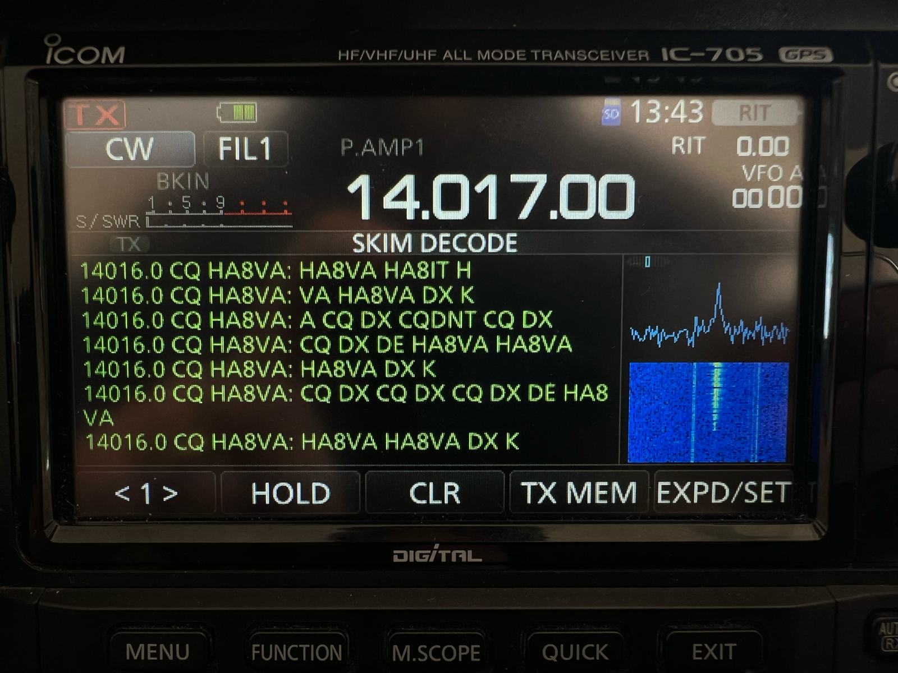

# SKIM — multi-signal CW decoder for the Icom IC-705

**Author:** Pablo Torres, EA5JLJ

A streaming CW (Morse) decoder written as freestanding C, and **SKIM**, a multi-signal CW decoder app for the **Icom IC-705** built on it, running SQ6EMM's custom firmware (ICAP platform).

- **Ready to use:** the compiled app is in [`app/`](app/): `SKIM.APP` and `SKIM.CFG`, built for SQ6EMM firmware release **20261119v14**. See [Installation](#installation); no compiler needed.
- **The radio app:** see [radio/README.md](radio/README.md) for installing and using SKIM.
- **This page** covers the decoder core, the desktop tools used to develop it, and test results.



*SKIM running on the IC-705 on 20 m: each line shows the station frequency, the station and whether it is calling CQ (`CQ HA8VA:`), and the decoded text. In a QSO the label shows who is working whom (`HA8VA>DL1ABC:`).*

## What the output looks like

Each line on the DECODE screen is one phrase from one station:

```
14022.0 HA40EUDXF>PD9W: PD9W 5NN
│       │         │     └ decoded text
│       │         └ the station it is working
│       └ the station transmitting
└ station frequency in kHz
```

The label in front of the text changes with what the station is doing:

| Label | Meaning |
|---|---|
| `CQ HA8VA:` | HA8VA is calling CQ. |
| `HA40EUDXF>PD9W:` | HA40EUDXF is in a QSO with PD9W. |
| `SX200H:` | Callsign known, but not calling CQ and the other station is not known yet. |
| *(none)* | The callsign is not known yet: too little text, or nothing that looks like a callsign. |

SKIM works out the callsigns from the text itself: the callsign after `DE` or `CQ`, or repeated, is the station transmitting; the one before `DE` or before a report (`5NN`, `599`) is the station it is calling. A callsign learned later appears from the next line on.

### A station calling CQ and working callers

From a real log (`SKIM12.LOG`, 20 m, unedited). The special-event station HA40EUDXF calls CQ, works AA3HEB, calls CQ again and works PD9W:

```
14022.0 HA40EUDXF>AA3HEB: TU HA40EUDXF
14022.0 CQ HA40EUDXF: CQ HA40EUDXF
14022.0 HA40EUDXF>PD9W: PD9W 5NN
14022.0 HA40EUDXF>PD9W: TU HA40EUDXF
14022.0 CQ HA40EUDXF: CQ HA40EUDXF
```

The callers are not in these lines: they were too weak here, or outside the passband. When they are heard, they get their own lines.

### Both sides of a QSO

When both stations are heard, each turn is labelled with the station sending it. If they are on the same frequency, SKIM tells the two operators apart by their signal level and keying speed. This example is illustrative, not from a log:

```
7025.0 CQ EA4XYZ: CQ CQ DE EA4XYZ EA4XYZ K
7025.0 DL1ABC>EA4XYZ: EA4XYZ DE DL1ABC DL1ABC K
7025.0 EA4XYZ>DL1ABC: DL1ABC DE EA4XYZ GM UR 5NN 5NN K
7025.0 DL1ABC>EA4XYZ: R TU 5NN 73 DE DL1ABC K
7025.0 EA4XYZ>DL1ABC: TU 73 EE
```

### Several stations at once

All the signals in the passband are decoded at the same time, each with its own frequency (from `SKIM10.LOG`, 15 m):

```
21016.0 CQ SX200H: CQ SX200H SX200H
21015.0 D3TUE
21016.0 SX200H>TA5FGJ: TA5FGJ 5NN
21023.0 KG2KJ BK
```

### Weak signals

With weak or fading signals some characters are wrong or missing, and SKIM keeps the label it already knows (from `SKIM10.LOG`):

```
21016.0 SX200H>TA5FGJ: A5F GJ GA HNN 73
21016.0 CQ SX200H: CQ SXEO00H SX200H
```

Every line is also written to `SKIMnn.LOG` on the SD card with the time, the audio tone and the raw decoded text (see [radio/README.md](radio/README.md#logs)).

## Installation

1. Requires SQ6EMM's custom firmware, release **`20261119v14`**, with its ICAP runtime files (`ICAPCOLD.BIN`, `ICAPSPOT.BIN`) in `\IC-705\Apps\`. Stock Icom firmware cannot run SKIM, and other releases are not supported. Follow the [firmware instructions](https://sq6emm.github.io/icom-custom-firmware/).
2. Copy [`app/SKIM.APP`](app/SKIM.APP) and [`app/SKIM.CFG`](app/SKIM.CFG) to `\IC-705\Apps\` on the microSD card. Keep the names in capitals.
3. Set `pitch` in `SKIM.CFG` to your radio's **CW PITCH** (press the MULTI knob in CW mode; factory default 600 Hz). It is needed to show each station's real frequency. If you use CW-R, also set `cwr=1`.
4. Put the radio in **CW**, press **RTTY** repeatedly until **SKIM** appears (RTTY → RTTY-R → SKIM), then press the mode button and go back to **CW**. The SKIM DECODE screen stays and the key keeps working. After switching the radio off and on, select SKIM again.

Details, settings and troubleshooting: [radio/README.md](radio/README.md).

Experimental software, receive only. Use entirely at your own risk; no warranty is provided (see [Notices](#notices)).

## Layout

| Path | What it is |
|---|---|
| `app/` | **Ready-to-use build:** `SKIM.APP` and its settings file `SKIM.CFG`, to copy to the radio's SD card. |
| `src/cwdec.c/.h` | Decoder core. C99 freestanding: no malloc, no libc, no libm (like `callsign` and `words`). Input: int16 audio at 8 kHz. Output: text per channel. About 157 KB of state: 3 KB per channel (up to 12), plus 117 KB of Viterbi state used only by the first 4 channels with `det=vit`/`auto`. |
| `src/callsign.c/.h` | Callsign, CQ and QSO-partner detection from decoded text. |
| `src/words.c/.h` | Word-spacing fix with a small CW vocabulary and the callsign rules: splits glued words (`CQCQDEEA4XYZ`), joins split callsigns (`EA4 XYZ`). Only moves spaces. |
| `radio/` | The SKIM ICAP app (`skim.c`), its settings (`SKIM.CFG`), build script and a desktop simulator of the ICAP loader (`icapsim.c`). |
| `tools/synth.c` | Synthetic CW generator: noise, hand-keying jitter, dash/dot ratio, QSB, drift, QRM, first element clipped by TX switching. |
| `tools/cwgen.c` | Writes a synthetic test WAV (`-c ms` clips the first element of each transmission). |
| `tools/cwfile.c` | Decodes a WAV file. Options: `-m` multi, `-c N` channels (default 8), `-V`/`-A` detector, `-f Hz`, `-R lo-hi`, `-r ref.txt` (CER against a reference), `-w` (word-spacing fix, as SKIM does), `-a`, `-v`. |
| `tools/wordfix.c` | Runs the word-spacing fix over SKIM logs or text and shows what it changes (`./build/wordfix SKIM01.LOG`). |
| `tools/analyze.c` | Spectrum peaks of a WAV, or an ASCII envelope at one tone (`analyze f.wav 765`). |
| `tools/bench.c` | SNR × WPM × condition sweep: CER and garbage on pure noise. `-V` / `-A` pick the detector. |
| `tools/sweep.sh`, `psweep.sh` | Compare `-DNAME=value` build variants on the synthetic bench (`psweep` in parallel). |
| `tools/realcheck.sh` | Compare build variants on your own recordings with reference transcripts (see below). |
| `CHANGELOG.md` | Improvements and fixes, newest first. |
| `LICENSE`, `THIRD_PARTY_NOTICES.md` | This project's MIT license, and credits for the ICAP SDK parts used to build the radio app. |
| `docs/` | Images for this page (`skim-ic705.png`: SKIM on the radio). |
| `results/` | Synthetic bench tables for each detector (`bench_thr.txt`, `bench_vit.txt`, `bench_auto.txt`). |

No audio files are included in the repository. See [Testing with your own audio](#testing-with-your-own-audio).

## Building

### Requirements

| What for | You need |
|---|---|
| Decoder core and desktop tools | A C99 compiler (gcc or clang) and `make` |
| Test scripts in `tools/*.sh` | `bash` |
| The radio app (`SKIM.APP`) | The Arm bare-metal toolchain `arm-none-eabi-gcc` (+ binutils), Python 3, and the [ICAP SDK](https://github.com/sq6emm/icap-sdk) |

Getting `arm-none-eabi-gcc`:
- **Linux (Debian/Ubuntu):** `sudo apt install gcc-arm-none-eabi binutils-arm-none-eabi`
- **macOS (Homebrew):** `brew install arm-none-eabi-gcc arm-none-eabi-binutils`
- **Windows:** the "Arm GNU Toolchain" installer from developer.arm.com, or the Linux packages under WSL.

**Use the ICAP SDK of the same release as the firmware on your radio.** The app talks to the firmware's loader through it, and the loader may refuse an app built for another release. Clone it next to this project, or point `ICAP_SDK` at it:

```bash
git clone https://github.com/sq6emm/icap-sdk ~/dev/icap-sdk
sh radio/build.sh                    # → radio/build/SKIM.APP and radio/build/icapsim
ICAP_SDK=/path/to/icap-sdk sh radio/build.sh   # if the SDK is elsewhere
sh radio/build.sh release            # also copies SKIM.APP and SKIM.CFG into app/
```

### Tested with

| Component | Version |
|---|---|
| Host OS | macOS 15 (Apple Silicon) |
| Host C compiler | Apple clang 15.0 |
| Arm compiler | arm-none-eabi-gcc 16.2.0 (Homebrew) |
| Python | 3.7 |
| make | GNU Make 3.81 |
| ICAP SDK | commit `3e3af4c` (2026-11-20), for firmware release **20261119v14** |
| Radio | IC-705 (E), SQ6EMM firmware 20261119v14 |

Linux and Windows builds have not been tested, but the code only uses standard C and the scripts only use `bash`, `sh` and `python3`.

## Quick start (desktop)

```bash
make
./build/cwgen test.wav -w 25 -s -3 -j 0.1 -t "CQ CQ DE EA4XYZ K"
./build/cwfile test.wav               # single station, threshold detector
./build/cwfile your_audio.wav -m      # multi mode: one line per station
./build/bench                         # synthetic benchmark (~20 s)
make check-freestanding               # the core must have no external symbols
```

## Modes and detectors

Mode and detector are independent choices:

| | What it does |
|---|---|
| **Single** (`CWD_MODE_SINGLE`) | One channel following the strongest station. |
| **Multi** (`CWD_MODE_MULTI`) | Up to 12 channels (4 with Viterbi or Auto), one per active tone, each with its own speed and text. |
| **Threshold** (`CWD_DET_THRESHOLD`) | Adaptive threshold with hysteresis. Low latency. Best on real audio so far. |
| **Viterbi** (`CWD_DET_VITERBI`) | Most likely dot/dash/gap sequence under a duration model (semi-Markov, 5 states, 4 ms ticks). Better on weak synthetic signals. About 15 units of delay. |
| **Auto** (`CWD_DET_AUTO`) | Runs both and, word by word, keeps the one expected to be better for the current SNR and speed. |

In multi mode the decoder:
- merges duplicate channels on the same signal;
- replaces the weakest recent station when a much stronger one appears;
- mutes a channel while a neighbour within 250 Hz is keying strongly enough to get through its filter, to stop crosstalk;
- keeps up to 3 operator timing profiles per channel, for operators taking turns on one frequency.

## How it works

1. **Tone search:** a Goertzel bank with a Hann window, in 15.6 Hz steps. The noise floor is the median, *inside* the receiver passband, of the spectrum with narrow peaks removed (a moving minimum over ±94 Hz), so many signals at once do not raise it. Bins the filter silences are ignored.
2. **Per channel:** I/Q mix to the tone, then a 4-pole low-pass whose time constant follows the speed.
3. **Envelope at 1 kHz:** signal and noise levels, threshold with hysteresis, and debounce.
4. **Timing:** k-means on recent mark and space lengths. Marks come out longer and spaces shorter by the same filter bias, so combining both cancels it. The word-gap threshold comes from each station's own measured letter and word gaps, so heavy keyer weighting does not glue words together and widely spaced operators are not split letter by letter. When several operators take turns on one frequency, each keeps its own timing profile (see below).
5. **Detector**, then Morse table lookup (including prosigns `<SK>`, `<KN>`…). The first element after a pause of 0.8 s or more is read as a dash from 1.5 units instead of 2: many transmitters in semi break-in cut it short while they switch to TX, and `TEST` would arrive as `EEST`. In synthetic tests with the first element cut by 1.4 units this recovers 81 of 144 `TEST`s (9 before) without misreading any dot.
6. **Double squelch:** the tone must stand out in the spectrum *and* the envelope must exceed the noise.
7. **Operator profiles:** a new transmission is detected by a long silence, or by a clear level jump (6 dB) after a pause or on 3 marks in a row. Its first 12 elements are held back. If they match a saved operator in level and speed, that operator's timing is loaded; if they fit the current timing, nothing changes (a fade); otherwise a new profile starts from its own elements.
8. **Word spacing** (`src/words.c`, used by SKIM and `cwfile -w`): splits glued words and joins split callsigns using a small CW vocabulary and the callsign rules. It only moves spaces, never letters.

## Results

### Synthetic benchmark

CER is the character error rate; SNR is measured in 2500 Hz; each cell is capped at 100 %.

| Detector | Mean CER (all) | Mean CER (SNR ≥ −10 dB) | Garbage on pure noise |
|---|---|---|---|
| Threshold | 44.3 % | 25.1 % | 0 chars/min |
| Viterbi | 42.6 % | 24.2 % | 1 char/min |
| Auto | 42.5 % | 23.9 % | 1 char/min |

- Viterbi wins on weak, slow signals: at −10 dB and 12 WPM it gets 14 % against 31 %.
- Threshold wins at 28–36 WPM and on hand keying with good signals.
- Neither decodes at −12 dB or below.

### Several operators and pile-ups

Synthetic tests with `cwgen` audio mixed together (`-m` multi mode):

| Test | Before | Now |
|---|---|---|
| QSO, two operators alternating on one frequency (one with heavy weighting, one widely spaced, 8–12 dB apart): CER | 14–17 % | 1 % |
| Pile-up of 10 stations 150 Hz apart, different levels and speeds: callsigns decoded (12 channels) | 0 of 10 | 10 of 10 |
| Same, 85 Hz apart | 0 of 10 | 6 of 10 |
| Real 40 m pile-up recording: distinct callsigns decoded (8 channels) | 3 | 8 |

Three changes made the difference:
- the noise floor now ignores narrow peaks, so it no longer rises with the number of signals;
- the crosstalk guard only mutes a channel when its filter would really let a neighbour through;
- each channel keeps the timing of up to 3 operators.

### Real off-air audio

Viterbi and auto only win on synthetic, white, stationary noise. On real receiver audio (AGC, QSB, compression) the threshold detector did better in our tests, so it is the default in SKIM.

## Testing with your own audio

All desktop tools take WAV files: mono or stereo, 8/16/24-bit PCM or 32-bit float, any sample rate. Audio is resampled to 8 kHz internally. Good sources are a recording of your receiver's audio output (for example the IC-705 over USB), a WebSDR recording, or any CW clip you are allowed to use.

Other formats (MP3, FLAC, OGG…) have to be converted to WAV first. Any audio tool will do, for example:

```bash
ffmpeg -i input.mp3 input.wav                 # Linux, macOS, Windows (ffmpeg.org)
sox input.mp3 input.wav                       # Linux, macOS, Windows (sox.sourceforge.net)
afconvert -f WAVE -d LEI16 input.mp3 input.wav   # macOS only, built in
```

Audacity (File > Export > WAV) also works.

Then:

```bash
./build/analyze input.wav             # which audio tones carry signals
./build/analyze input.wav 700         # ASCII envelope at 700 Hz (to read it by eye)
./build/cwfile input.wav              # strongest station
./build/cwfile input.wav -m           # several stations, one line each
./build/cwfile input.wav -m -R 1000-3400   # if the tones are outside 200–2600 Hz
radio/build/icapsim input.wav -d /tmp/apps -m SKIM   # the whole radio app, simulated
```

To measure accuracy, write what was actually sent in a text file. Then compare:

```bash
./build/cwfile input.wav -r input.txt          # prints the CER
./build/cwfile input.wav -w -r input.txt       # the same, with the word-spacing fix
```

To compare build variants on several recordings, put `NAME.wav` in `audio/` and `NAME.txt` in `refs/` (both are ignored by git), and run:

```bash
tools/realcheck.sh "" "-DFILT_DIV=11.0f"      # one result per variant and recording
```

## Next steps

- Make Viterbi robust on real audio: let mark levels track QSB, and use a letter model.
- Measure CPU load on the radio.
- Combine copies of the same transmission received on two channels (diversity).
- A shareable set of test recordings with reference transcripts.

## Notices

- **Independent project.** SKIM is **not affiliated with, authorized by, or endorsed by** Icom Inc. or SQ6EMM.
- **Trademarks.** *Icom*, *IC-705* and *IC-9700* are trademarks of Icom Inc. They are used here only to identify compatible equipment.
- **No Icom code.** This project contains no Icom code or firmware and grants no rights to any Icom firmware. It only uses the public ICAP API (`icap.h`) from SQ6EMM's MIT-licensed SDK.
- **Third-party components.** The ICAP SDK and the custom firmware are SQ6EMM's work. Get them from their original source: <https://github.com/sq6emm>.
- **Not included.** This repository does not include Icom firmware, SQ6EMM's custom firmware, or the ICAP runtime files (`ICAPCOLD.BIN`, `ICAPSPOT.BIN`). Get them from SQ6EMM (<https://github.com/sq6emm>). Credits for the SDK parts used to build `SKIM.APP` are in [THIRD_PARTY_NOTICES.md](THIRD_PARTY_NOTICES.md).
- **Use at your own risk.** SKIM is receive-only and never transmits, but using it requires modified radio firmware. Installing it may damage the radio and may void its warranty. The software is provided "as is", without warranty of any kind (see LICENSE). You are responsible for operating within your licence and your national regulations.

## Author and licence

Pablo Torres, **EA5JLJ**.

Released under the **MIT License**: see [LICENSE](LICENSE). You may use, modify and share it, including in other projects, as long as the copyright notice is kept.
